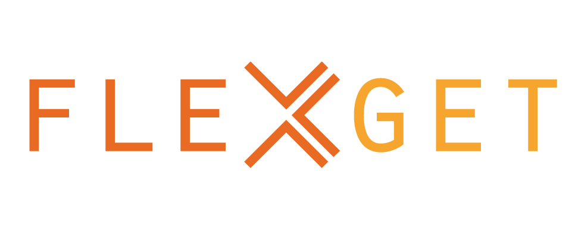
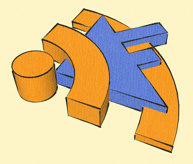
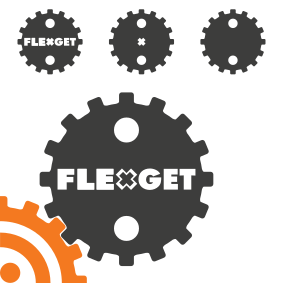
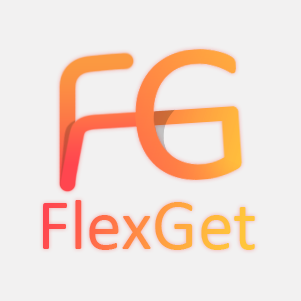

# Logo ~~Wanted~~ Picked!
We picked a logo! Thank you everybody for your contributions, we got a lot of nice ones. After some discussion decided to go with the logo by Linus Olsson, thank you Linus!

See LogoAndIcons for assets.

~~We are looking for a nice logo for FlexGet. Something suitable for favicon, program icon, and website use (does not all have to be the same version of logo.) Please submit your ideas! There is no particular deadline, nor a winner guaranteed. We are just looking for some help coming up with a good logo. You can edit this page.~~

 -  by gazpachoking

 -  by Zundrium

 -  by mrskitch

 -  by LAX2TLV

 -  by voods

 -  by anscarlett

 -  by lispington

 -  by alto

 -  by shtimn

 -  by PrDatur

 -  by Ron Casey

 -  by Nmaib0

 -  by Linus Olsson

## Attachments
* [Logo by Zundrium](logo-contest/flexget.psd)
* [flexget-logo.png](logo-contest/flexget-logo.png)
* [FlexGet logo offering, in Adobe Illustrator format](logo-contest/FlexGet-002.ai)
* [FlexGet Logo by ClappingFetus](logo-contest/flexget.jpg)
* [logo_alto.svg](logo-contest/logo_alto.svg)
* [flexgetlogo_1024.png](logo-contest/flexgetlogo_1024.png)
* [FlexGet colors, with simple font](logo-contest/FlexGet_Simple_Font.png)
* [by PrDatur](logo-contest/flexget.png)
* [FlexGet_gears.svg](logo-contest/FlexGet_gears.svg)
* [by Nmaib0](logo-contest/flexget-logo-Nmaib0.png)
* [by Nmaib0](logo-contest/flexgetbyNmaib0.psd)
* [Logo by Linus Olsson](logo-contest/PastedGraphic-3.png)